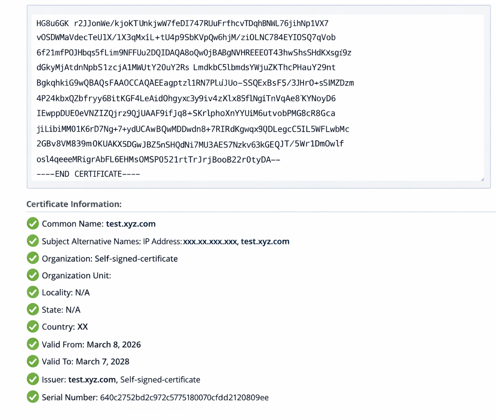

= Modificare il flag di convalida del certificato negli ONTAP tools
:allow-uri-read: 
:icons: font
:imagesdir: ../media/

[role="lead"]
Per impostazione predefinita, la convalida dei certificati è abilitata per i certificati backend di storage ONTAP. Se necessario, puoi impostare il flag di convalida dei certificati su false per ignorare i controlli dei certificati SAN. Questa impostazione non si applica ai certificati del server vCenter.

.Prima di iniziare
Ti servono le credenziali dell'utente di manutenzione.

.Fasi
. Accedi al vCenter Server.
. Individua la macchina virtuale ONTAP tools e avvia la console web.
. Accedi utilizzando le `maint` credenziali.
. Entra `1` per selezionare il menu *Configurazione applicazione*.
. Premi Invio `3` per modificare il flag di convalida del certificato.
+
La console di manutenzione mostra lo stato del flag di convalida del certificato e richiede di modificarlo.

. Inserisci 'y' per attivare/disattivare il flag oppure 'n' per annullare.

Quando la convalida del certificato è abilitata, ONTAP tools verifica che tutti i backend di storage utilizzino certificati con un Subject Alternative Name (SAN). Se un backend di storage utilizza un certificato senza SAN, non puoi abilitare la convalida. Prima di abilitare questa opzione, verifica che tutti i backend di storage utilizzino certificati basati su SAN. Se disabiliti l'opzione, ONTAP tools ignora la convalida del certificato per tutti i backend di storage configurati.

[[verify-san-based-certificates-for-storage-backends]]
== Verificare i certificati basati su SAN per i backend di storage

Per garantire una comunicazione sicura e una convalida adeguata, verificare che tutti i backend di archiviazione utilizzino certificati basati su SAN:

. Verificare che il certificato di gestione ONTAP includa una voce Subject Alternative Name (SAN).
. Confermare che le voci SAN corrispondano all'indirizzo IP di gestione ONTAP o al nome DNS, o a entrambi.
. Assicurarsi che i dettagli utilizzati per integrare ONTAP corrispondano all'indirizzo IP o al nome DNS nella voce SAN del certificato.

Questi passaggi aiutano a prevenire problemi di convalida dei certificati e a mantenere il sistema ONTAP integrato in modo sicuro.

Il seguente certificato di esempio mostra le informazioni decodificate:

